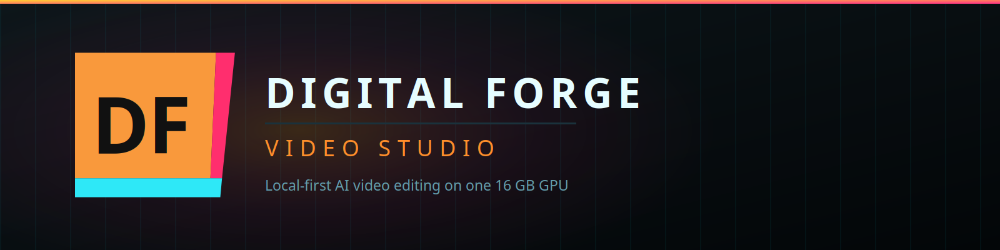

# Digital Forge — brand pack

Master assets for Digital Forge and every product under it. **[GUIDELINES.md](GUIDELINES.md) has
the rules**; this file is the index and the how-to.



---

## What is here

| Folder | Contents |
|---|---|
| `logo/` | The mark in every variant, the wordmark, and the studio + product lockups |
| `logo/product/` | Per-product lockups and `_template-horizontal.svg` for new ones |
| `icon/png/` | Application icons, 16 → 1024, plus `contact-sheet.png` for judging small sizes |
| `ui/` | Splash, watermark, corner bug, empty state, chrome motif reference |
| `social/` | GitHub social card (1280×640), OG image (1200×630), README banner (1600×400) |
| `palette/` | `palette.json`, `palette.css`, and a rendered swatch sheet |

## Picking a file

**Application icon** → `icon/png/df-icon-*.png`
**Favicon** → `icon/favicon.svg`, or `df-icon-32.png`
**Anywhere** → `logo/df-mark.svg`. It is transparent and its body is opaque, so it holds on light,
dark and mid backgrounds without a variant. The dark tile is **not** part of the logo.
**App icon / favicon only** → `logo/icon-tile/df-tile-dark.svg`
**One colour only** — embroidery, laser, single-colour print → `df-mark-mono-light/dark/ember.svg`
**Over footage** → `ui/watermark.svg`
**Below 33px** → `logo/df-mark-small.svg`. This matters; see the guidelines.

---

## Regenerating

Every PNG here is derived from the SVG sources. **Do not retouch a PNG** — fix the geometry in
`build.py` and rebuild, or your change disappears on the next run.

```bash
pip install cairosvg pillow
python brand/build.py
```

### A note on fonts

The SVGs carry live text in the real brand stack — Outfit, Inter, DM Mono — matching
`src/styles.css` exactly. They render correctly anywhere those fonts are installed.

The PNGs committed here were rendered on a machine **without** them, so their text fell back to a
neutral grotesque. It is close, and fine for a README, but it is not canonical. Install
[Outfit](https://fonts.google.com/specimen/Outfit) and [Inter](https://fonts.google.com/specimen/Inter)
and re-run `build.py` before using anything for print or promotion.

---

## Applying the icon to the app

Tauri generates every platform format — `.ico`, `.icns`, Android, Windows Store tiles — from one
source image. Do not hand-build them:

```powershell
npm.cmd run tauri icon brand/icon/png/df-icon-1024.png
```

That rewrites `src-tauri/icons/` in full. Commit the result.

`assets/app-icon.svg` is the human-editable source and should stay in step with
`brand/logo/df-mark.svg`.

---

## Adding a product

1. Copy `logo/product/_template-horizontal.svg`.
2. Change the product name string. Nothing else.
3. Add it to `build.py` so it regenerates with everything else.

Resist the urge to give a new product its own mark or its own accent colour. The lockup system is
what makes two products look like one studio, and it stops working the moment one of them opts out.

---

## Licence

These brand assets are **not** covered by the project's source licence. The Digital Forge name, the
mark and the lockups are trademarks of the project owner.

You may reproduce them unmodified to refer to or link back to this project — write-ups, articles,
package listings, a "built with" badge. You may not use them to brand your own product, imply
endorsement, or as part of a logo or product name of your own. Modified versions of the mark are
not permitted.

Everything else in the repository is under [FSL-1.1-ALv2](../LICENSE.md), which explicitly does not
grant trademark rights.
